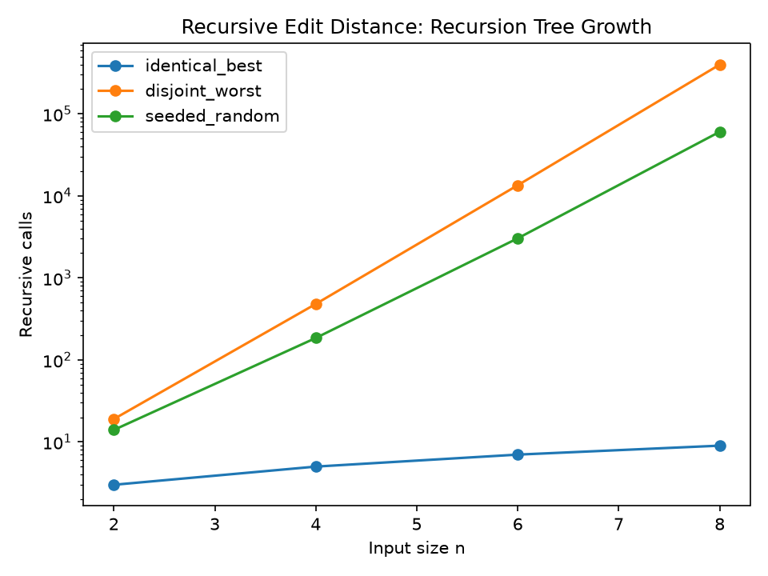
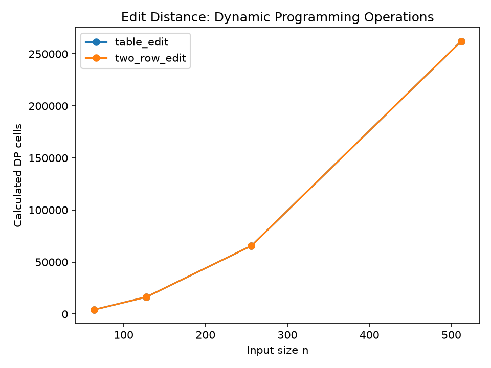
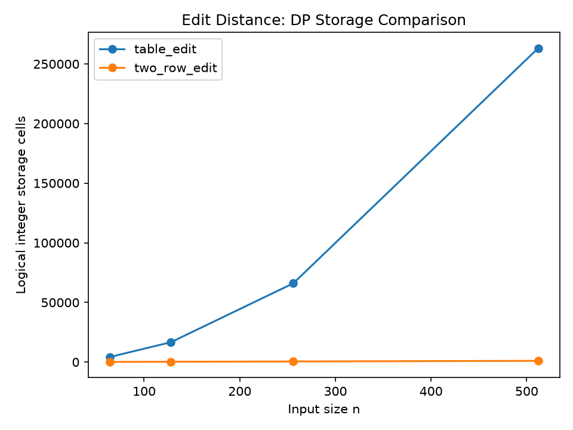
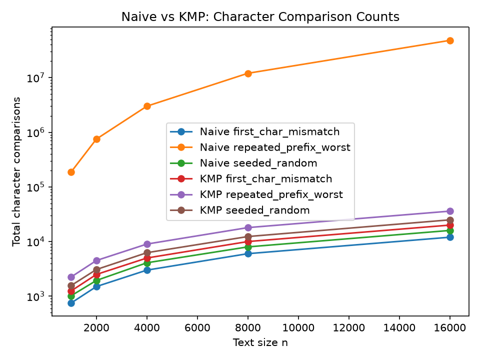
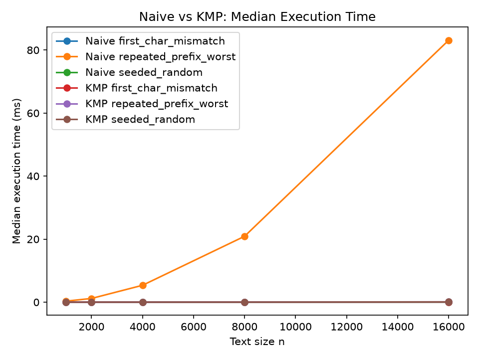

# Assignment 4 — City Search & Spell-Check

Student: Temujin Gonchar  \
Group: SE-2518  \
Assignment: 4 — City Search & Spell-Check

## Experiment Design Card

**Research question.** How do input content and implementation strategy affect work, logical storage, and measured time for edit distance and string search?

**Inputs.** Recursive edit distance uses n=2,4,6,8; DP uses n=64,128,256,512. Both use `identical_best`, `disjoint_worst`, and deterministic `seeded_random` inputs. Search uses text n=1000,2000,4000,8000,16000, pattern length n/4, and `first_char_mismatch`, `repeated_prefix_worst`, and deterministic `seeded_random` inputs. Random generators use documented seeds derived from size (edit 991+n; search 2025+n) and alphabet ABCD.

**Metrics.** Recursive calls; calculated DP cells and logical allocated integer slots; Naive comparisons; KMP LPS, search, and total comparisons. These measure algorithmic work and logical storage, not JVM heap bytes.

**Predictions.** Recursive calls will grow rapidly for disjoint inputs and remain smaller for matching suffixes. Both DP methods will calculate n² cells, while two-row storage will grow linearly. Naive will be favorable for first-character mismatches but expensive for repeated prefixes; KMP total comparisons will remain near linear, including LPS preprocessing.

**Planned plots.** Recursion growth, DP operations, DP storage, comparison counts, and median time, all generated from `results/results.csv`.

## Methodology

`BenchmarkRunner` performs three warm-up executions and five timed samples per configuration using `System.nanoTime()`. A calibration step chooses one repetition count per configuration (up to 10,000) so short calls are measurable; each recorded time is total elapsed time divided by repetitions. The median is used in plots, while all five samples remain in the CSV. A volatile checksum consumes returned results.

Counters are collected in a separate instrumented execution before timing, so counter instrumentation is not included in wall-clock measurements and repeated timed calls are not mistaken for operation counts. Java array headers and object overhead are excluded from logical storage. Times depend on hardware, JVM state, background load, and warm-up, so they are observations rather than universal guarantees.

## Results and plots

The recursion plot shows content-sensitive branching and rapid growth on disjoint inputs.

Both DP implementations calculate the same n² interior cells.

The full table grows quadratically while two rows grow linearly with the shorter dimension.

Naive comparisons vary strongly by pattern, while KMP total comparisons include preprocessing and are much less repetitive.

Median time generally follows comparison-count trends, with small-machine and JVM noise possible.

## Prediction vs result

For edit distance, the predicted quadratic DP work and storage difference are directly reflected by the counters. Recursive calls are content-sensitive: equal suffix characters take the diagonal branch, whereas disjoint inputs expose the three-way recurrence. The recursive sizes were intentionally capped because the recursion tree becomes impractical quickly.

For string search, the predicted favorable Naive case is the first-character mismatch, while the repeated-prefix case causes repeated long prefix comparisons. KMP pays LPS preprocessing but reuses border information and never moves its text index backward. Timing broadly follows these operation patterns, though operation counts are more stable evidence than individual milliseconds.

## Required short answers

**Which input made string search slowest, and why?** The repeated-prefix input is the intended slow case for Naive: each alignment matches almost the whole pattern before failing. The CSV comparison counts show that repeated work. KMP avoids most of this repetition by following LPS links.

**How large an n could recursive Edit Distance handle, and what stopped it?** This experiment used n only through 8. The limiting factor is the exponential recursion tree and its rapidly increasing call count, not the correctness of the recurrence. Larger cases would make repeated subproblems dominate runtime.

**What do you gain and lose with two rows?** Two rows reduce logical DP storage from (n+1)(m+1) cells to two arrays of length min(n,m)+1. The distance and calculated-cell count remain the same. The tradeoff is that the complete matrix is unavailable for reconstructing an edit script.

**Which search should a city platform use?** KMP is the safer general choice when patterns may be repetitive, because its worst-case work is linear in text plus pattern length. Naive search is simpler and can be competitive for tiny inputs or immediate mismatches. The experiment shows why the workload should be considered rather than choosing only by a single timing.

## One paragraph on time

Measured times are noisy because machines, JVM compilation, garbage collection, and background processes differ. Warm-up lets frequently executed code reach a more representative JIT state, and five samples plus a median reduce the influence of outliers. Counters provide additional evidence because they count defined algorithmic events independent of clock resolution. One benchmark measurement is insufficient to establish a universal performance claim.

## Final comparison

| Algorithm | Theoretical time | Logical storage | Measured metric | Practical note |
|---|---:|---:|---|---|
| Recursive edit | exponential worst case | recursion stack | recursiveCalls | transparent but quickly impractical |
| Table edit | O(nm) | O(nm) | cells, storage | supports full matrix |
| Two-row edit | O(nm) | O(min(n,m)) | cells, storage | memory efficient, no full matrix |
| Naive search | O((n-m+1)m) worst | O(1) besides result | comparisons, time | simple; repeated prefixes hurt |
| KMP | O(n+m) | O(m) LPS | LPS/search/total comparisons, time | robust for repetitive patterns |

Theoretical complexity, actual operation counts, wall-clock time, and logical storage answer different questions; equal counts do not imply equal execution time.
